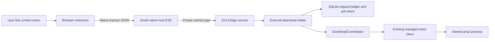

# Browser download handoff: architecture and design review

Status: proposed architecture, not implemented. Reviewed against this repository and official documentation on 2026-10-11. Read with [implementation plan](BROWSER_HANDOFF_IMPLEMENTATION_PLAN.md) and [protocol and acceptance specification](BROWSER_HANDOFF_PROTOCOL_AND_TESTS.md). The intended implementer is GPT-6.1 Sol; the review and planning request does not authorize silently treating proposed classes as existing code.

## 1. Recommended outcome

Build a browser extension that can send a link to the existing AriaGUI download pipeline through a small native messaging host and a private Windows named pipe. Start with an explicit **Download with AriaGUI** link context-menu command. Chrome and Edge share most extension source; Firefox gets a separately generated manifest and tested background entry point. Keep automatic interception and browser credentials as later, separately gated capabilities.

This improves the route from browser to downloader. It cannot make an origin server support resuming, preserve an expired authorization token, or convert browser-created content into a normal URL. Existing browser partial files will not be imported. AriaGUI starts a fresh transfer, whose later resume depends on server behavior and the app's existing partial-file/control-file recovery rules.

The proposed extension → native host → named pipe → GUI → aria2 topology is sound. The proposed assumption that `downloads.onCreated` can transparently replace every browser download is not. Nor is “cancel browser, then send JSON” a safe fail-open algorithm. Ship a useful explicit handoff first, with accurate status and no automatic browser cancellation.

## 2. What already exists

These are source observations, not proposed interfaces:

| Area | Current source and behavior | Consequence for this feature |
|---|---|---|
| Composition/startup | `src/AriaGui.App/App.xaml.cs` creates DI registrations, main window, preferences loading, download synchronization and engine lifecycle tasks in `OnLaunched`. | Register the bridge here, but do not accept work until its dependencies have initialized. |
| GUI singleton | `OnLaunched` acquires `SingleInstanceLease`; a secondary requests the existing tray window then exits. `src/AriaGui.Infrastructure/Aria2/SingleInstanceLease.cs` uses an exclusive `app.lock` file in the runtime directory. | There is already GUI exclusion despite the class living under `Aria2`. It does not forward a structured download payload. |
| Runtime paths | `src/AriaGui.App/Services/AppDataPaths.cs` distinguishes packaged LocalState from unpackaged private runtime storage; debug/verification builds can use a marked fixture. | A host must resolve the selected installation/profile; never guess all app data lives at one fixed path. Production must not discover test markers. |
| Add workflow | `src/AriaGui.Application/Downloads/DownloadCoordinator.cs`, `AddAsync`, validates HTTP(S), rejects URL user-info, resolves destination, generates job/attempt/GID and commits durable intent before aria2. It returns `Task`, not a job receipt. | Extend/refactor this path; do not bypass it with host-side JSON-RPC. |
| Ambiguous mutations | An uncertain engine add is saved as `OperationStatus.Uncertain`; the coordinator reconciles the saved GID instead of blindly adding again. | An IPC timeout cannot mean “nothing happened.” The bridge needs durable request IDs and queryable results. |
| Engine request | `src/AriaGui.Application/Downloads/IAria2Client.cs` defines `EngineDownloadRequest` with URL, destination, filename, continue and paused state; no browser headers or cookies. | Authentication is new work across contracts, persistence, recovery and RPC, not a one-line extension change. |
| RPC | `src/AriaGui.Infrastructure/Aria2/Aria2RpcClient.cs` uses authenticated loopback RPC, fixed safe options, no overwrite/renaming, certificate checking, one connection/split. | Keep RPC secret and port entirely inside app infrastructure. No extension-side RPC access. |
| Session recovery | `Aria2ProcessManager.cs` configures `save-session-interval=5` and explicitly calls `SaveSessionAsync` at several lifecycle boundaries. | Cookies passed as options may escape into engine session artifacts. “We did not put them in SQLite” is insufficient. |
| History | `DownloadDbContext.cs` contains Jobs, Attempts, Files, Operations and QueuePolicies. Destination key and engine ID are unique. `SqliteDownloadRepository.cs` stores complete `Source.AbsoluteUri`. | Signed URLs are already durable sensitive data. Add a request ledger atomically with job intent and audit exports/backups. |
| Destination | `FileDownloadDestination.cs` requires an absolute local app-selected directory, validates a single filename, probes writability and refuses existing files/control files. | Preserve these rules. Browser absolute filenames are never output authority. |
| Preferences | `src/AriaGui.Application/Downloads/UserPreferences.cs`, JSON repository and `PreferencesViewModel`; startup applies `DefaultFolder` to `DownloadsViewModel.DirectoryPath`. | A background intake service must read the initialized preference model, not scrape UI text or use an uninitialized textbox. |
| Exit | `ExitOwnedAsync` cancels operations, waits, checkpoints and stops engine before disposal. | Stop bridge admission first, drain accepted work under a bounded lifecycle policy, then preserve existing shutdown ordering. |
| Distribution | `AriaGui.App.csproj` supports MSIX release and explicit unpackaged builds. `scripts/Package.ps1` produces a versioned unsigned MSIX candidate; signing/acceptance are separate. | An unpackaged EXE artifact is not an installer. Browser registry registration/update/uninstall are additional deliverables. |

Do not change the meaning of the existing manual Add command while introducing external receipts. Keep its UI error behavior through a wrapper if a new result-returning core method is introduced.

## 3. Review of the proposed browser approach

### Download events are observation, not an atomic interception hook

Chrome's `onCreated` runs when a download begins. Metadata can subsequently change; `filename` is an absolute local path and `finalUrl` reflects redirects. `cancel()` completion does not prove the transfer was canceled before completion. `erase()` separately removes browser history, not the file. These semantics prohibit the simple “cancel + erase + forward” algorithm from guaranteeing no loss or duplicates. [Chrome downloads API](https://developer.chrome.com/docs/extensions/reference/api/downloads)

A browser item does not supply a complete replayable HTTP request. Inferring GET from an HTTP URL is unsafe: a POST-generated export may use that URL. Re-fetching may consume a one-time URL. Blob/data/filesystem URLs and service-worker-generated responses may have no equivalent remote request. An extension must say unsupported rather than invent a GET and claim success.

For v1, the user explicitly selects an HTTP(S) link. AriaGUI performs GET; its UI explains this when a site requires a browser-generated export. No downloads permission is necessary for the context-menu-only phase. Do not attach a global downloads listener in that phase merely because it will be useful later.

### Native messaging is the correct bridge, with two distinct transports

The browser starts a host process and exchanges UTF-8 JSON with a four-byte native-order length prefix. Chrome limits host replies to 1 MB and browser requests to 64 MiB; our own cap is much smaller. `sendNativeMessage` creates a host for each message, whereas `connectNative` supports a port lifetime. Windows implementation uses binary standard streams; stdout must contain only protocol frames. [Chrome native messaging](https://developer.chrome.com/docs/extensions/develop/concepts/native-messaging)

Firefox also uses framed JSON, but its native manifest authorizes extension IDs with `allowed_extensions`, not Chromium `allowed_origins`; its documented inbound maximum differs. Do not reuse one native manifest for both. [Mozilla native messaging](https://developer.mozilla.org/en-US/docs/Mozilla/Add-ons/WebExtensions/Native_messaging)

The named pipe between host and GUI is a separate, app-owned transport. Use the same bounded JSON body and an explicitly little-endian length prefix there. The host is a relay and launcher, not a downloader, database writer, persistent queue, or aria2 supervisor.

### Cookies are not a general authentication export

Browser cookie access needs `cookies` and matching host permissions. Cookie stores and partition keys matter; a simplistic domain-wide query is not equivalent to the Cookie header a request would actually send. SameSite, secure/path/domain matching, containers, private browsing, partitioned storage and redirects all affect scope. [Chrome cookies API](https://developer.chrome.com/docs/extensions/reference/api/cookies), [Mozilla cookies API](https://developer.mozilla.org/en-US/docs/Mozilla/Add-ons/WebExtensions/API/cookies)

Do not read cookies at all in v1. Later support must be user-enabled, origin-scoped and based on a demonstrable request context. Do not dump the cookie database, request all-site access by default, read browser profile databases, collect bearer tokens from pages, or promise replay of integrated Windows authentication/client certificates. HttpOnly is not a reason to broaden access: treat accessible HttpOnly cookies as highly sensitive session credentials.

An arbitrary `headers` object is also rejected. Browser APIs constrain headers; native aria2 is not subject to the browser's forbidden-header guard, which makes careless forwarding more dangerous rather than more compatible. Use typed, allowlisted fields only; reject CR/LF/NUL and reject Host, Content-Length, Connection, Transfer-Encoding, proxy headers, Range and unreviewed `Sec-*` fields. Do not manufacture an Origin or forward Authorization across redirects. [Forbidden request headers](https://developer.mozilla.org/en-US/docs/Glossary/Forbidden_request_header)

### MV3 requires durable orchestration

Chromium may stop the service worker, losing global variables. Native ports affect lifecycle but are not a substitute for crash recovery. Register listeners synchronously at the entry point, persist nonsecret request IDs/state, and recover by querying the host/app after reconnection. Avoid an endlessly running keepalive loop. [Chrome extension worker lifecycle](https://developer.chrome.com/docs/extensions/develop/concepts/service-workers/lifecycle)

Generate Firefox background settings separately: the current Mozilla reference lists `background.scripts`/event pages and does not support `background.service_worker` in Firefox. Sharing TypeScript logic does not imply identical background packaging. Pin minimum supported browser versions after compatibility testing. [Mozilla background manifest](https://developer.mozilla.org/en-US/docs/Mozilla/Add-ons/WebExtensions/manifest.json/background)

### Protocol handlers are untrusted activation

An `ariagui://...` URL is invocable by a webpage or another local program. It has no native-messaging allowlist or trusted browser identity and may be exposed in shell/browser diagnostics. Do not embed cookies, headers, secrets, output paths or arbitrary commands in it. Recommended v1: no protocol handler. Later: `ariagui://open` and, if required, a bounded `add?url=` request that opens a visible confirmation with HTTP(S) validation; never silent acceptance. The confirmation is a product safety boundary for untrusted activation.

Packaged protocol registration is a package-manifest concern; unpackaged registration uses the Windows App SDK activation registration route. They need separate installation tests. [Windows URI activation](https://learn.microsoft.com/en-us/windows/apps/develop/launch/handle-uri-activation)

## 4. Component boundaries

Proposed projects/directories (none exist merely because they are listed here):

| Proposed location | Responsibility | Must not do |
|---|---|---|
| `src/AriaGui.Browser.Contracts` | Bounded protocol DTOs, parser/validator, version and error codes. No WinUI. | Reference RPC secrets, app database or shell execution. |
| `src/AriaGui.NativeHost` | Binary stdin/stdout, caller argument validation, installation lookup, one bounded GUI launch, pipe relay, safe diagnostics. | Add directly to aria2 or decide a download succeeded. |
| `src/AriaGui.Application/Browser` | Intake policy, idempotent request state and result mapping, preference readiness, proposed repository contract. | Depend on browser JavaScript or WinUI widgets. |
| `src/AriaGui.Infrastructure/Browser` | Pipe endpoint/ACL and install discovery, ledger persistence integration where appropriate. | Execute payload command lines. |
| `src/AriaGui.App/Services` | DI/lifecycle integration, UI dispatch, browser connection settings and incoming-request feedback. | Perform blocking pipe I/O on the UI thread. |
| `extensions/ariagui` | Shared typed protocol/client/state reducer, generated Chrome/Edge/Firefox manifests, popup/options/context menu. | Expose RPC endpoint, allow arbitrary webpage messaging, or read cookies in v1. |

A lightweight shared contracts project is justified because host must not pull in WinUI or the full infrastructure graph. It can target the repository's current .NET version; publish it as part of a self-contained host. NativeAOT is an optional later packaging optimization, not a v1 prerequisite.

## 5. Startup, instance routing and lifecycle

Retain `SingleInstanceLease` for v1. The primary instance creates the pipe after private-runtime validation, preferences load and repository migration/init have succeeded. Readiness includes a usable intake service, not merely a window handle. Return `not_ready` before then. The host retries pipe connection with bounded backoff, optionally launches the selected installed GUI once, and queries again. The launch has a fixed executable and fixed switch such as `--browser-wakeup`; the download payload never becomes an argument. Existing process-start races are resolved by the existing lease; a secondary may continue using tray activation and exit.

Derive pipe identity from product channel, selected installation/profile and user identity. Resolve installation through a private per-user registration descriptor written by the installer. Do not enumerate arbitrary directories or connect to a pipe supplied by the extension. Packaged and unpackaged runtimes must not accidentally share a pipe while owning separate databases. First version supports one selected installation per channel; settings/installer can switch deliberately.

AppInstance is a reasonable later replacement for activation routing, but adding it alongside the lease without a single ownership model creates disagreement/deadlock risks. A migration must use an early custom Main, the generated-main opt-out, key registration and redirected activation handling before app initialization; preserve the engine's separate ownership/recovery protections. Compare behavior for startup, tray show, protocol, cold activation and simultaneous launches. [WinUI single-instance guidance](https://learn.microsoft.com/en-us/windows/apps/windows-app-sdk/applifecycle/applifecycle-single-instance)

On shutdown, stop admitting new mutations and return `shutting_down`. Finish or persist already accepted intake work; do not tie durable acceptance to the browser socket's lifetime. Close pipe listeners and host connections, then run the existing coordinator/engine checkpoint flow. A lost client is not a request to remove a job.

## 6. Security and privacy model

The main trust boundary is between browser-supplied data and local file/network actions. The extension ID allowlist restricts browser clients; native host argument checks are defense in depth. Arguments can be spoofed by arbitrary local programs, so they are not cryptographic proof of browser identity. No protection is promised against malicious software already executing as the same Windows user with access to that user's processes and files.

Use an explicit pipe DACL restricted to the intended user/logon scope, reject remote pipe clients, and verify client/server identity where the implementation permits. Test both same-user normal-integrity operation and cross-user denial. Default pipe security is not sufficient for confidential messages. Consider first-instance creation and expected server process/path verification to detect pipe squatting; fail closed on identity mismatch. Do not elevate host or app to make IPC easier. [Windows named pipe security](https://learn.microsoft.com/en-us/windows/win32/ipc/named-pipe-security-and-access-rights)

All boundaries validate frame size before allocation, JSON depth, field lengths, schema version, action, URI scheme and filename. The app is authoritative even if extension/host already checked. Reject URL embedded credentials, malformed escapes/control characters, non-HTTP(S), arbitrary RPC options, shell tokens and external output directories. Strip URL fragments for network identity but preserve the URL query semantics; do not decode/re-encode a signed URL opportunistically.

For untrusted protocol requests, always show destination/origin confirmation and prevent silent repeated prompts through rate limits. For native context-menu requests, user action is the normal intent signal, but local/private-network targets require explicit product policy: v1 rejects loopback/link-local/private literals by default and offers no automatic-capture exceptions. DNS rebinding/redirects mean a string filter is not a complete network isolation boundary; do not advertise SSRF isolation without transport-level enforcement. This is a desktop downloader with user-selected network access, not a server-side fetch service.

The app selects the directory from initialized preferences. A suggested filename is only a single basename; strip neither traversal nor invalid characters silently into a surprising name—reject or show an app-side rename choice. Ignore browser directory components entirely. Preserve no-overwrite and history uniqueness. Never open/run a file automatically. Browser malware scanning and reputation protections do not automatically transfer to aria2; add Windows attachment/MOTW handling as a release gate for downloaded browser-origin files, and document the remaining difference without claiming equivalent browser protection.

No raw URL, query, cookie, header, clipboard value or JSON payload in logs/telemetry/error dialogs. Diagnostics use request ID, result code, duration and redacted origin when needed. Current history stores source URLs: explain this in settings/help, redact diagnostics/export, and preserve the same private-directory/backup protections. Avoid source URL persistence in extension storage; the browser already has link context during a gesture, while an unresolved request can be queried using only its ID.

## 7. Credentialed downloads: a separate release gate

Do not expose cookie permissions or send credentials until a security spike has examined the bundled aria2 version's session behavior, redirects and recovery. The manual documents session saving and configurable headers/cookies, but does not establish that app-provided secrets stay out of all artifacts. Existing five-second session snapshots make this a concrete risk. [aria2 manual](https://aria2.github.io/manual/en/html/aria2c.html)

The spike must use synthetic unique markers and inspect session files, session backups, SQLite/WAL/backups, engine config/logs, diagnostics bundles and normal/crash/forced-stop recovery. It must test cross-origin and HTTPS→HTTP redirects with a controlled server. If arbitrary Cookie headers leak across origins or into disk artifacts, the feature stays disabled.

Preferred later policy is ephemeral credentials, lost on app/engine restart, with a visible “sign in and send again” recovery state. This requires a proven mechanism to prevent engine serialization; a small encrypted app vault alone does not solve plaintext aria2 session writing. Alternatives requiring new design approval are an isolated nonpersistent engine, a carefully audited per-download persistence mechanism, or explicit encrypted credential persistence with platform protection and clearly bounded lifecycle. Never “encrypt after save” and claim plaintext was never written. Memory/dump exposure cannot be eliminated by managed-string zeroing claims.

Cookie selection must use the originating store/partition/container and exact target URL; absent context means unsupported. Redirect credential policy must be enforced by the transport, not only by extension-side initial URL checks. Arbitrary bearer headers, POST bodies, client certificates, private browsing and cross-container sharing remain outside initial credential support.

## 8. Automatic capture and the unavoidable distributed transaction

V1 is explicit handoff only. A future opt-in automatic mode can observe eligible downloads, but requires a prepare/commit flow described in the protocol document. It must start with allowlisted public GET cases whose replayability is established by more than `DownloadItem.url`; otherwise leave the browser alone. No global cookie capture, page-injected hooks, blocking webRequest assumptions or blanket cancellation.

Browser cancellation and SQLite commit cannot be one transaction. If cancellation happens first and the app fails, the browser may not be resumable. If app start happens first and cancellation fails, both can download. Lost acknowledgments introduce another ambiguity. Pause/resume reduces risk but does not prove atomicity, and worker/browser crashes can leave paused items.

Therefore product wording is **best-effort takeover**, not guaranteed fail-open. Before cancellation, failures leave/resume the browser and abort an uncommitted reservation. After confirmed cancellation, the app owns recovery of the committed intent; if commit acknowledgment is lost, query the same request ID. Never automatically restart the original browser download on an unknown commit result. A bounded recovery UI shows what is known and offers deliberate action. Preserve canceled browser history by default; never erase history as transaction cleanup.

## 9. Installation and compatibility decisions

The browser extension and native host are separate installed products. Install the host and GUI at stable paths under a per-user product directory; create browser-specific native manifest files with exact allowlists. Chrome/Edge store IDs and development IDs differ. Firefox gets an explicit stable add-on ID. No wildcard allowlist. Development registration uses a separate host name/channel and cannot silently overwrite production registration.

Windows registry default values point to the host manifest, not directly to the EXE. Use browser-specific HKCU keys under `Software\Google\Chrome\NativeMessagingHosts`, `Software\Microsoft\Edge\NativeMessagingHosts` and `Software\Mozilla\NativeMessagingHosts`. Generate each manifest with an absolute installed host path. Test the registry views/browser lookup rules on x64 Windows instead of relying on Edge fallback to another browser's registration. [Chrome installation](https://developer.chrome.com/docs/extensions/develop/concepts/native-messaging), [Edge native messaging](https://learn.microsoft.com/en-us/microsoft-edge/extensions/developer-guide/native-messaging), [Firefox setup](https://developer.mozilla.org/en-US/docs/Mozilla/Add-ons/WebExtensions/Native_messaging)

First supported deployment: per-user unpackaged installer plus Chrome/Edge, then Firefox acceptance on the same host. Preserve existing MSIX production tooling; do not assert that copying a host EXE into an MSIX makes native messaging discoverable. Packaged support needs its own stable launcher/registration proof on a clean machine, including update and uninstall. If that proof is not ready, explicitly label browser integration unavailable for that package rather than shipping a broken registration.

Install/update writes files before switching registry references, performs a health handshake, and rolls back registration if validation fails. Uninstall removes only product-owned matching values/manifests; it does not delete downloaded files or history. Portable folder moves require explicit repair/re-registration. Do not silently register on every app launch. Store submission/publishing is outside the local implementation task.

## 10. Decisions versus remaining questions

**Decided for v1:** native messaging + private pipe; explicit context-menu GET; current GUI lease retained; app-selected destination; durable request ledger and job receipt; no cookies/arbitrary headers, no automatic cancellation/history erasure, no protocol handler, no browser partial-file import, no RPC secret in extension; minimum permissions; typed error codes; one installation/channel selected explicitly.

**Must be resolved in implementation spikes:** installer technology and signing channel; exact minimum browser versions; Firefox background build configuration; packaged host launch/registration; attachment marking integration; pipe peer verification implementation and ACL tests; sensitive URL retention/diagnostics audit; endpoint conflict repair UX.

**Requires a later explicit scope decision:** automatic capture eligibility evidence and residual failure UX; cookie/credential lifetime; private-browsing support; protocol URL import; origin/private-network policy exceptions; any POST/blob/browser-response streaming support. A future implementer must not fill these gaps by quietly enabling broad permissions.
