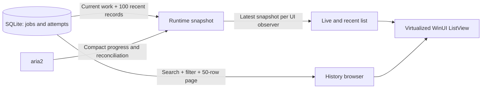

# Phase 6: responsive downloads and browsable history

Implemented on 6 October 2026. This phase adds search, status filters, history pages, saved theme/folder preferences, file/folder actions, and less work during progress updates. Phase 5 recovery and command persistence remain in place.

## What to try

Run `scripts/Run.ps1 -Unpackaged`. If an earlier preview is already running, use its tray **Open AriaGUI → Exit** first so the script can update its files. Close continues to hide to the tray.

- **Add a download** expands the URL/destination form; it starts collapsed to leave room for the list.
- **Ctrl+F** focuses search. Search matches filename, source, or destination; the status dropdown narrows the list.
- The normal list shows live downloads and up to 100 recent completed/failed/removed records. The footer's completed count describes this recent window, not all-time history.
- **Browse saved history** searches all completed/failed/removed jobs in SQLite. **Previous/Next** move through 50-record pages; **Refresh history** rereads the current page. Live transfers remain in the normal list; switch back to see them.
- **Preferences** saves Windows/light/dark theme and a default folder for new downloads. An empty folder restores `Downloads/AriaGUI`. The queue's simultaneous-download setting remains durable from Phase 4.
- Completed rows offer **Open file**; rows offer **Open folder**. Windows resolves the item asynchronously when clicked. A deleted/inaccessible file or folder produces a readable error while preserving history. Controls reflect eligibility from job status, not a guarantee that the disk item still exists.

The empty state distinguishes an empty list from a search with no matches. Rows show commands appropriate to their status rather than every disabled action. Search and controls have accessible names; list containers receive the actual filename when created or recycled. Alt access keys include S for search, H for history, P for preferences, and D for Download when its form is open.

## Lesson 1: live state and history have different sizes

Previously startup loaded every job, attempt, file, and operation into memory. Each list update walked and ordered all those rows. A completed job could continue making the screen expensive despite requiring no engine progress checks.

`DownloadBrowsing.RetainRecent` keeps unfinished/uncertain work plus at most 100 ordinary terminal records. `DownloadRuntimeStore` applies this rule at every publication. Terminal transitions are saved to SQLite before their old rows leave the runtime window. Unresolved commands are retained even if their last observed status is terminal.

`SqliteDownloadRepository.LoadCurrentAsync` reads current attempts plus recent terminal attempts. `LoadPageAsync` filters/counts in SQLite and selects at most 100 rows (the screen requests 50), then materializes only their files and pending operations. History has stable creation-time/job-ID ordering. It returns one latest attempt per job, so Retry does not duplicate a job in history. A newly active retry leaves the terminal-history result set.

`GetAsync` loads one older job on demand when you Retry a row outside the runtime window. Destination collision checks query saved history directly; trimming the UI cannot make an old destination available accidentally. Startup uses compact saved GID identities to recognize owned engine inventory, rather than loading all old domain objects. The legacy full-history `LoadAsync` remains for tests/diagnostics; the production startup and browser use the bounded APIs.

Recent retention uses the latest observed activity (the existing `UpdatedAtUtcTicks` field in SQLite), rather than attempt start time alone. A transfer that started weeks ago but completes now stays in the recent window; a regression test verifies that its completion is persisted before any older row is trimmed.

## Lesson 2: polling has two speeds

Trace `DownloadCoordinator.RunAsync` and `Aria2ProcessManager.ObserveDownloadsAsync`:

| Work | Cadence/bound |
| --- | --- |
| Active transfers or pending commands | 500 ms between completed refreshes |
| Waiting/paused/interrupted work | 2 seconds between refreshes |
| Idle or disconnected state | 5 seconds between refreshes |
| Waiting order, stopped reconciliation, engine inventory/settings | At most every 5 seconds in normal operation; new IDs and commands trigger an earlier check |
| A previously active GID disappears | Immediate status check during that refresh |

The loop awaits each refresh and then its delay; it does not accumulate timer work. The real process manager serializes RPC with its existing gate. Explicit observations can still overlap at the coordinator boundary during reconnection/tests, so the existing generation/epoch/sequence guards remain necessary; real engine calls remain serialized.

Fast updates use `tellActive` with six selected progress fields. Full status checks use `system.multicall`, limited to **64 GIDs per HTTP request**, with a token in every subcall. Response IDs, transfer IDs, statuses, and sizes are validated. Missing-ID errors remain distinct from authentication/malformed-response failures.

The manager caches slower observations. When an active transfer disappears, it checks that ID immediately so Completed/Failed/Removed can be persisted without waiting for the next full inventory pass. A missing ID is still interruption evidence, not completion evidence. Unknown inventory entries continue to be reported without receiving commands.

Checkpoint saves fetch selected attempts/files/operations in batches rather than performing separate EF queries for each row. Regular progress checkpoints remain throttled; changes in status or operation outcome are saved promptly.

## Lesson 3: a UI queue should not remember obsolete progress

`RuntimeViewModel` now keeps the newest pending snapshot and schedules at most **one runtime callback per observer**. If 50 refreshes happen before WinUI handles its queue, the list and summary each apply the newest snapshot once. This bound applies to runtime-observer callbacks, not every command/error/preference callback in the app.

Commands are not carried by this progress queue. Their intents/outcomes are already serialized and durable through the coordinator and SQLite. Terminal records are persisted before presentation is coalesced; completion receipts remain durable. We coalesce presentation work, not engine mutations or database transactions.

`DownloadsViewModel` indexes rows by job ID, reuses unchanged row objects, and only moves collection entries when their order changes. Unchanged entries skip redundant property notifications. Running command tasks remain tracked even if their row disappears during search or a page change, so Exit can cancel and await them.

`DownloadsPage` keeps the ListView in a finite `*` Grid row with an `ItemsStackPanel`; it is not nested in a ScrollViewer. WinUI can recycle offscreen containers. Database paging limits materialized history rows; UI virtualization limits rendered row controls. These solve different problems.

## Lesson 4: search is asynchronous and cancellable

Live/recent search filters the small current snapshot. Historical search waits **250 ms** after a change and cancels the superseded query. SQLite work stays behind the existing serialized background boundary. Cancellation cannot interrupt a SQLite statement that is already executing; only one repository operation executes at a time, and stale results are rejected using a browser revision.

Switching out of history cancels its load. Query/page bounds prevent huge page sizes or unbounded text input. A failed read leaves stored data untouched and provides a Refresh history action. Older page responses cannot replace newer search results.

## Lesson 5: preferences and Windows actions stay at the edge

`UserPreferences` defines the small settings contract. `JsonUserPreferencesRepository` validates values, limits the file to 16 KiB, and writes atomically inside the protected runtime folder. Corrupt settings are preserved and default behavior is reported. No schema migration or new production package was needed for this phase.

`PreferencesViewModel` loads/saves settings; `App` applies the requested WinUI theme and new-download default folder. `WindowsDownloadFileActions` uses Windows Storage/Launcher asynchronously, with cancellation and readable missing/access errors. The ViewModels depend on interfaces so tests exercise these behaviors without opening files or changing Windows settings.

## Verification — 6 October 2026

The final full locked restore/build/test run passed **133 tests**: 16 Core, 51 Application, and 66 Infrastructure, none skipped. The solution build and separate unpackaged preview build both finished with **zero warnings and errors**. Tests include an older-transfer completion/retention regression, the Phase 5 crash fixtures, real HTTP downloads, queue/retry regressions, compact-RPC authentication/identity checks, settings round-trip/corruption/size/access checks, and the large-history profile.

The separate compiled preview is in `artifacts/phase6-preview`; it was built without replacing the files used by the running older preview. This build has not been launched for native UI verification. Exit the existing app through its tray menu before running `scripts/Run.ps1 -Unpackaged` to load Phase 6 normally.

Before profiling, budgets were set to **1,000 ms per warm current/history query**, **100 ms for applying a snapshot**, and **16 MiB additional retained managed memory** for the runtime/ViewModel portion. Object/work bounds are 100 recent records, 50 history rows per UI page, and one queued runtime callback per observer. These are development-machine budgets, not release guarantees.

The recorded reference environment is Windows 11 build 26200, .NET runtime 10.0.9, 12 logical processors, and Debug .NET test execution. The workload creates 10,000 terminal historical jobs and 100 simulated active transfers in an isolated real SQLite database, then publishes 50 refreshes before draining the UI callbacks.

| Measurement | Recorded result |
| --- | --- |
| Warm current-state load | 75.2 ms |
| Warm 50-row history page | 241.4 ms |
| Apply newest snapshot to ViewModels | 1.07 ms |
| Additional retained managed memory | 0.90 MiB |
| Runtime rows | 200: 100 live + 100 recent |
| History page | 50 rows, with 10,000 matching terminal jobs |
| Queued runtime callbacks after 50 updates | 2: list + summary |
| Concurrent observations in this simulated workload | 1 |

`artifacts/phase6-profile.json` is the reproducible machine-readable result and is regenerated by `ScaleTests`; timings can vary. Tests assert page/filter semantics, disjoint pages, bounded callbacks/rows, existing row reuse, retrying an older job without bulk history loading, and the declared budgets.

**Scope of measurement:** this profiles SQLite/application/ViewModel behavior, not native rendering, input latency, scrolling frame rate, or whole-process working set. Native responsiveness and screen-reader traversal still require manual inspection. The existing preview was minimized; Computer Use could not restore usable input geometry and reported `window is minimized`. Native Phase 6 smoke checks remain pending. Phase 5's actual tray/sleep/disk-full acceptance checks, packaged launch, and debugger exercises are also still pending.

Next: Phase 7 covers packaging, upgrades, signing, and clean-machine installation. The manual checks above remain tracked rather than being treated as passed by a build.

## References

**8 October follow-up:** the published unpackaged EXE now has native smoke evidence for search/history browsing, preferences, downloads, pause/resume, and close/relaunch. See [NATIVE_EXE_TEST.md](NATIVE_EXE_TEST.md), including the unresolved initial history discrepancy and smaller-window layout observations. Native scale and screen-reader checks remain pending.

The virtualization layout follows Microsoft's [ListView/GridView performance guidance](https://learn.microsoft.com/en-us/windows/apps/develop/performance/optimize-gridview-and-listview). Compact polling uses the selected fields and batch methods documented in the [aria2 RPC interface](https://aria2.github.io/manual/en/html/aria2c.html#rpc-interface).
