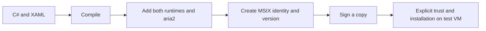

# Phase 7: from a build to an installable candidate

Implemented locally on 6 October 2026. Packaging code, development signing, upgrade protection, diagnostics export, and release tooling are verified locally. Clean-machine acceptance and public redistribution remain pending; see RELEASE_ACCEPTANCE.md.

## Lesson 1: build, publish, package, sign, install

A build compiles our C# and XAML. Publishing adds the files needed to run that compiled app. Packaging wraps those files in an MSIX with an identity, version, Windows requirement, and Start-menu entry. Signing binds the package to a publisher and detects modification. Installation registers it with Windows.

These are distinct steps: creating an MSIX does not install it, and a development signature does not automatically make another machine trust it.

Run from the project root:

    .\scripts\Package.ps1

The default script performs the locked restore/build/full test run before preparing the Release package. It restores the app's release configuration, collects declared dependency notices, publishes an x64 self-contained MSIX, validates it, and writes a unique run folder under artifacts/packages/0.7.0.0. It also copies the release notes, guide, acceptance matrix, and redistribution review record beside the candidate. It does not change Windows settings, certificate trust, or installed applications.

Use -SkipVerification only when the exact source was already verified; it skips the tests, not package-content validation. Failed commands stop the script. Output from each run is separate so a new build does not silently replace a previous candidate.

## Lesson 2: there are two runtimes

Our managed code uses .NET. WinUI uses the Windows App SDK runtime. SelfContained=true bundles .NET; WindowsAppSDKSelfContained=true bundles the Windows App SDK. We enable both in the app's AriaGuiRelease property group, leaving ordinary development builds smaller.

The release pins the .NET runtime to 10.0.9 and keeps the existing exact NuGet locks. It is a folder of files inside an MSIX: native WinUI/SQLite/engine binaries stay alongside managed assemblies. Trimming, single-file publishing, and ReadyToRun are disabled for this initial candidate to keep deployment straightforward.

Trace these files:

- AriaGui.App.csproj: app-only release switches and notice inclusion.
- Package.appxmanifest: stable development identity, 0.7.0.0 version, Windows 11 x64 target, full-trust desktop entry point.
- Package.ps1: runs checks, prepares notices, builds, and creates the candidate.
- Test-Package.ps1: inspects the actual archive, not just project properties.

Package validation checks the compiled manifest, absence of framework-package dependencies, embedded .NET runtime declaration, core runtime/WinUI/SQLite files, aria2 hash and notices, dependency inventory, and absence of databases, secrets, session files, logs, test executables, private keys, or symbols. It verifies every block-mapped file's bytes, the signed CMS message, and the native Windows package-trust result. Its JSON report records package SHA-256, size, runtime versions, and signature/trust state.

The supported declaration is Windows 11 x64 build 22000 or later. It is not a claim that every declared build has passed installation testing.

## Lesson 3: development signing is a local file operation

After creating an unsigned candidate:

    .\scripts\Sign-Package.ps1 -PackagePath <candidate-path> -Development

This creates a self-signed code-signing certificate in an access-restricted .tools/signing folder and signs a copy of the candidate with the pinned SDK's SignTool. The public AriaGUI.Development.cer and signing/package reports go beside the signed MSIX. It does not install a certificate into a Windows certificate store or register the app. The passwordless development PFX is protected by the folder ACL and is never included in the package or CI artifacts.

Keep the private PFX on the development machine. A disposable test VM may explicitly trust the public certificate; this is a test trust decision, not production signing. Confirm the publisher and certificate thumbprint first. Production signing supports a provided CurrentUser/My certificate thumbprint and an HTTPS RFC 3161 timestamp URL; select the final publisher and signing policy before distributing publicly.

    .\scripts\Sign-Package.ps1 -PackagePath <candidate-path> -CertificateThumbprint <thumbprint> -TimestampUrl <https-timestamp-service>

The certificate must have a private key, match the manifest publisher exactly, and be unexpired. Output is never silently replaced. A signature can be present and validly formed while its self-signed certificate is untrusted; package reports keep that distinction visible. Windows PowerShell maps this MSIX's untrusted-root result to UnknownError; the validator checks the actual native trust result (800B0109) rather than accepting generic errors or depending on translated message text.

## Lesson 4: installation folders are read-only; state is separate

AppDataPaths checks native package identity. A packaged app uses ApplicationData.Current.LocalFolder/Engine (the package's LocalState). An unpackaged preview continues to use %LOCALAPPDATA%\AriaGUI\Engine. The engine executable is resolved from AppContext.BaseDirectory/Engine; writable files never belong beside it in the install folder.

This makes the lifecycle explicit: package upgrades retain LocalState, and Windows uninstall removes package-managed state. Downloads in the default Downloads/AriaGUI folder are external and remain. A custom destination inside LocalState would be removed too.

The preview and installed package have separate history/settings/session folders, with no automatic import. Both currently use port 16800, so Exit one before running the other. Do not force-copy a live SQLite database or engine session into another runtime folder.

## Lesson 5: upgrade the schema only after a verified backup

SQLite schema versions are recorded in __EFMigrationsHistory. DatabaseSchemaUpgrade compares applied migrations with this executable's known migrations. A newer unknown migration causes a readable refusal, preserving history; we do not silently open newer data with an older app.

When an existing database needs migration, SQLite's online backup API captures committed data, including data still in the WAL. The copy is written to the protected Backups folder and checked with PRAGMA quick_check before EF applies migrations. A failed backup prevents migration. A failed migration reports recovery guidance and retains the original and verified backup; no automatic reset or rollback occurs.

UpgradeTests builds actual Phase 3 and Phase 4 schemas, inserts history and pending pause/resume/queue intent, upgrades, and checks preserved identities/progress/intent. It also tests blocked backup creation, a conflicting-table migration failure, unknown newer schema, and corrupt database preservation.

Current-schema startup creates no new backup. Backups are kept until deliberately managed; they are private data, not diagnostics attachments. See RELEASE_ACCEPTANCE.md for the offline restore procedure and package-upgrade/uninstall matrix.

## Lesson 6: diagnostics use an allowlist

    .\scripts\Export-Diagnostics.ps1 -RuntimeDirectory <actual-Engine-folder>

This writes bounded engine logs and metadata to a new artifacts/diagnostics folder. It excludes configuration, sessions, database contents, preferences, ownership records, downloads, and backups. It redacts the current RPC secret, credential-like log fields, URLs, and Windows paths. Review exports before sharing.

Test-ReleaseTools.ps1 uses disposable modified packages to verify rejection of an altered engine, missing runtime, private-data leakage, and an unsigned candidate when a signature is required. With -SignedPackagePath, it also checks a valid development signature, altered app assembly, and a changed signed block map whose individual file hashes still match. Its diagnostics fixture checks redaction and preservation of the source configuration.

## Lesson 7: build automation and distribution are separate

The prepared .github/workflows/windows.yml runs on Windows, installs the SDK from global.json, runs Package.ps1, checks release tools, and retains test/profile/package evidence. Official actions are pinned to immutable revisions. It has read-only repository permissions and never signs, installs, publishes a release, or uploads private keys.

No Git remote is configured in this workspace. The workflow is prepared source; it has not run on a hosted runner. Activating it requires a hosted GitHub repository and committing/pushing the project separately.

Engine/notices and collected NuGet/.NET notices are in the candidate. Public binary redistribution still needs the complete corresponding-source and native-dependency review/delivery recorded in THIRD_PARTY.md. Packaging alone does not settle those obligations or choose a license for this project.

## Verification record

The final locked restore/build/test run passed **139 tests**: 16 Core, 51 Application, and 72 Infrastructure, none skipped. The solution build had **zero warnings and errors**. Six new upgrade cases cover old schemas with live WAL data, backup access failure, migration failure, newer schema refusal, and corrupt database preservation.

The Release MSIX build succeeded with **one non-blocking warning**: the SDK could not find the optional mspdbcmf.exe symbol-package helper. The candidate intentionally excludes debug symbols; package generation and content validation succeeded. Release properties were checked after evaluation: both runtimes self-contained, trimming/single-file/ReadyToRun disabled.

The final candidate folder is:

    artifacts/packages/0.7.0.0/20261006T134945Z-61bba09c2e2f48d2ad670ec467f0ade0

| Evidence | Recorded result |
| --- | --- |
| Development-signed MSIX | AriaGUI_0.7.0.0_x64_development.msix |
| Size / entries | 101,496,642 bytes (96.8 MiB), 601 entries |
| Package SHA-256 | 10400AA604D7D01CABEB04BE144C46BDBF1705BA542BE9291DADD58EAB7B840C |
| Embedded .NET / Windows App SDK dependency pin | 10.0.9 / 2.5.1 |
| Engine | aria2 1.37.0; exact pinned binary/notices verified |
| Dependency inventory | 41 package/runtime entries with collected declared notices |
| Block map and cryptographic signature | Verified |
| Certificate trust | UntrustedRoot (800B0109); trust not installed |
| Development certificate thumbprint | 38D48AC1BE87DE92BDF67CFE81D09C7760ADD032 |
| Current-user My/Root/TrustedPeople stores | Generated certificate absent |
| Release-tool checks | 9 passed, including signed-assembly/block-map tampering and diagnostics redaction |
| Scale regression | 100 live / 10,000 historical jobs, 200 runtime rows, two queued runtime callbacks; budgets passed |

package-report.json, signed-package-report.json, signing-report.json, the public .cer, unsigned/signed candidates, collected notices, and release documents are beside the candidate. artifacts/release-tools-results.json records the nine tool checks; artifacts/test-results holds the final TRX results. The private development key stays in the protected .tools/signing folder and is not part of these deliverables.

No package or certificate was installed, no VM was started, and no release was published. The prepared CI workflow has not run remotely because no Git remote is configured. Clean-machine install, native UI, versioned MSIX upgrade, uninstall, production signing, and public redistribution remain pending; **Phase 7 acceptance remains open**.

## References

**8 October follow-up:** fixed unpackaged publishing to include the generated PRI/XBF resources and tested the EXE on this host. See [NATIVE_EXE_TEST.md](NATIVE_EXE_TEST.md) for results and remaining findings. The MSIX candidate above was not rebuilt or installed during that smoke test; Phase 7 acceptance remains open.

- [Microsoft self-contained deployment](https://learn.microsoft.com/en-us/windows/apps/package-and-deploy/self-contained-deploy/deploy-self-contained-apps)
- [Single-project MSIX](https://learn.microsoft.com/en-us/windows/apps/windows-app-sdk/single-project-msix)
- [SignTool package signing](https://learn.microsoft.com/en-us/windows/msix/package/sign-app-package-using-signtool)
- [Packaged desktop filesystem behavior](https://learn.microsoft.com/en-us/windows/msix/desktop/desktop-to-uwp-behind-the-scenes)
- [aria2 license](https://aria2.github.io/#license)
