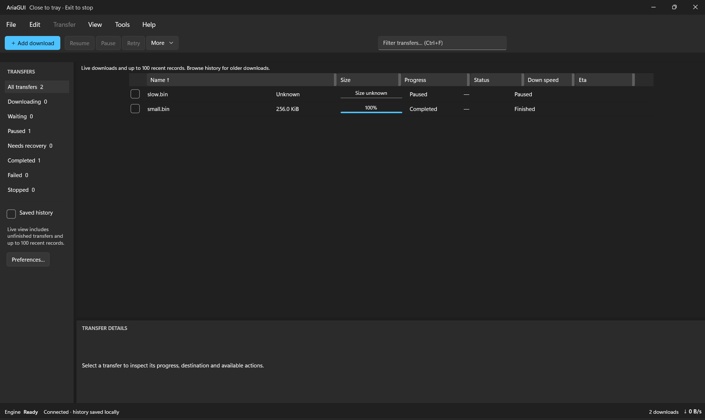

# Responsive desktop layout: review and implementation plan

10 October 2026. Status: **R0 historical gaps remain; R1/R2/R3 targeted cases pass; R4 targeted functional checks and174 tests pass, but idle CPU and matrix gaps keep release unpublished**. This responds to the user's maximized-window screenshot and request to review resizing before coding. It supplements `DESKTOP_UI_PLAN.md` and takes priority over the previous fixed-width layout approach. R1 corrected the fixed canvas gap and two independently reproduced row lifecycle defects. R2's final overlay-focus repair passed native verification, along with boundary crossings, hidden-sidebar intent and long notices at scale1.25. See `R1_VERIFICATION.md`, `R2_VERIFICATION.md`, `R3_VERIFICATION.md` and `R4_VERIFICATION.md` for executed evidence and limits.

## Review evidence

The screenshot shows a substantial inset between the sidebar and transfer table, unused space beside the table, a filter field floating within the toolbar, and row values appearing under the wrong headings. For example, the first row's Size value appears inside the Name header's horizontal span. The unused area below two rows is normal list capacity; it should remain available for additional rows. The defects are horizontal space allocation, column alignment and components failing to adapt to their available area.

This review inspected the current XAML, layout handlers, dialogs, window initialization and saved-layout contract. A subsequent R0 native pass reproduced the screenshot's wide table gap and capped search placement in the current primary EXE, while the apparent large header/body mismatch did not recur. The original screenshot's executable identity, saved widths, display scale and resize/filter sequence remain unknown. Code findings below distinguish established causes from risks that still need controlled measurement.

## R0 audit outcome

R0 reports and evidence:

- [Static layout audit](R0_LAYOUT_AUDIT.md)
- [Native measurements](R0_NATIVE_MEASUREMENTS.md)
- [Runtime/settings provenance](R0_RUNTIME_CONTEXT.md)
- [Astra evidence evaluation](R0_EVALUATION.md)
- Native screenshots under `artifacts/r0-layout`

The running primary EXE reproduced the large lateral table gap and capped/floating search at a maximized 1536 × 912 observation image. Source inspection establishes that `TableCanvas.Width` is the visible preferred-width sum plus 80, independent of the viewport. Together these provide strong evidence for the table's failure to fill a wide workspace. The current run did not reproduce the user's apparent large header/body mismatch after maximize/restore, filter recreation or horizontal scrolling; it only establishes that the source lacks a reliable shared geometry contract. Keep the reported mismatch open without assigning it to recycling or a specific callback.

R0 remains partial because controlled client-DIP/DPI bounds, loaded preference revision, reversible customization, vertical-scrollbar recycling, narrow sizes, pane recovery and proposed breakpoints were not measured. The observed live layout also disagreed with the on-disk preferences at the unpackaged runtime path. R1 must establish an unchanged-layout instrumented baseline and isolate that provenance discrepancy without overwriting user data.

| Component | Current evidence | Planned correction |
| --- | --- | --- |
| Table viewport | `DownloadsPage.ApplyLayout` assigns `TableCanvas.Width` to the sum of saved widths plus 80, regardless of available viewport width | Anchor the table to the workspace's leading edge and make its content at least as wide as its viewport; allocate spare space deliberately |
| Header and rows | Header and row grids have separate XAML defaults and are rebuilt independently. Header padding is 38/16, row selection gutter is 32, and row setup relies on realization callbacks | Use one resolved column layout for every header and row, with shared gutter/inset/scrollbar measurements; remove offset patches as the alignment mechanism |
| Search and actions | Search is capped at 280 inside a `*` column; action buttons occupy an unwrapping horizontal StackPanel | Give search an intentional edge/row, flexible usable width and a narrow-window state; move secondary commands into overflow before they clip |
| Sidebar filters | Fixed pane width; labels and counts are joined into a single string; only limited pixel clamps respond to window size | Stretch filter rows, separate label/count columns, and use an accessible filter overlay when a docked sidebar no longer fits |
| Details pane | Starts at 180; can retain a large empty selection prompt; status/size/queue and action groups are horizontal StackPanels | Size against available workspace height, use a compact empty state, and reflow selected details into one or two columns |
| Resize and preferences | `WorkspaceSizeChanged` only clamps two pane dimensions. `ApplyLayout` reapplies stored values; every preference PropertyChanged calls it | Separate saved user intent from effective dimensions, recompute all dependent components together and avoid overwriting user choices during automatic resizing |
| Notices and history controls | Empty batch text retains margins; notices can grow; history navigation is an unwrapping row beside explanatory text | Collapse empty content completely, bound long notices and reflow navigation while preserving a usable transfer viewport |
| Footer | Several Auto columns compete with the connection-message `*` column | Prioritize engine health and speed, trim secondary text, then use a compact footer state at small widths |
| Dialogs | Add/Preferences have a 320 minimum content width; generated dialogs also use fixed minimum widths and horizontal groups | Constrain content to the current client area, allow internal vertical scrolling and responsive action/field arrangements |
| Window and DPI | Initial window size comes from physical work-area pixels; no comprehensive client-size/DPI layout policy | Calculate layout from actual client size in logical pixels and translate physical window constraints at the monitor boundary |

## Design rules

### Shared table geometry

Keep the virtualized native ListView and its stable job-ID selection. A single layout calculation supplies the ordered visible column IDs, effective widths, selection gutter and trailing scrollbar allowance to both header and every realized row. Recycled rows receive the current layout version before display. Width changes must not recreate the download collection, reset selection or alter engine queue order.

Use **fit available width** as the default table mode, with **manual column widths** available in View/Columns for users who want an exact layout. A user's dragged widths are preferred widths, distinct from computed render widths. Existing saved widths migrate to preferred widths; existing order and visibility remain intact.

- Let `V` be the table's measured visible width. Subtract the shared selection gutter, measured template insets and any space occupied by the vertical scrollbar to obtain the column budget.
- Give the six supported columns semantic minimum widths. Initial targets in logical pixels: Name 180, Size 100, Progress 120, Status 110, Speed 90, ETA 90; scale/measure content for larger text. Keep the selection gutter a shared layout token, initially 32.
- In fit mode, start from validated preferred widths. Allocate spare width to Name. When space is tight, reduce widths toward their semantic minimums, starting with Name's extra width; use a deterministic remaining-column priority. If minimum widths still exceed the budget, allow horizontal scrolling inside the table.
- In manual mode, retain preferred widths and use horizontal scrolling when needed. Any trailing blank area is an intentional table background on the right; the table remains anchored at the left. It must never be centered within surplus space.
- Header and body share one horizontal scroll offset. Only the ListView owns vertical scrolling, with finite available height so virtualization is preserved. Account for scrollbar appearance/disappearance without moving one part independently.
- Hiding, reordering or resizing a column recalculates the same layout for header and rows. Do not silently hide data columns as the window narrows. Keep Name visible under the existing rule.
- Do not stretch row heights to fill a short list. Compact/comfortable row density remains independent of window height, with room for accessibility text scaling.

The implementation must explicitly own or measure the native item-template insets. Replacing one hard-coded header offset with another is not the solution. Pixel rounding happens consistently for all consumers of the shared geometry.

### Adaptive component behavior

Use actual **client-area width in logical pixels (DIPs)**, not screenshot pixels or outer-window width. These are initial design thresholds to validate in the native app, with content-fit checks for larger fonts/localization. Width and height adaptation are independent.

| State | Initial client-width target | Behavior |
| --- | --- | --- |
| Wide | 1100 DIPs and above | Docked resizable sidebar; commands on the left; search anchored to the toolbar's right with a comfortable 240–420 DIP width; table fills its workspace; details may use two columns |
| Regular | 800–1099 DIPs | Sidebar stays docked while preserving a useful table viewport; search moves to a full-width second toolbar row; less-used actions use More; details reflow as required |
| Compact | 560–799 DIPs | Sidebar becomes an overlay opened by a labeled Filters button showing current filter; search gets its own full-width row; Add, key selection actions and More remain reachable; table alone may scroll horizontally |

At every state, command/search groups must fit their measured content. If they do not, use the next more compact arrangement rather than clip them. Plan a supported minimum client area of approximately **560 × 420 DIPs**, subject to R0 measurement; clamp any window minimum to the available work area so smaller displays remain reachable. Menu access, Add, filtering, More and Exit must remain usable at the minimum. Small-window support must come from reflow, not merely a larger imposed minimum.

Specific component rules:

1. **Toolbar/search:** preserve one search value, selection and focus across state changes. Ctrl+F reveals/focuses the search control in every state. Overflow reuses the existing command instances and eligibility rules. A field should have a stable left/right anchor; increasing window width must not make it drift to an arbitrary center position.
2. **Sidebar:** status text uses a stretch column, count uses a right-aligned Auto column. Trim long labels with an accessible full name/tooltip. The overlay retains status/history selections and keyboard navigation; returning to a wider window restores the user's preferred docked width and visibility. An explicitly hidden sidebar stays hidden until requested; filter access remains available through the Filters command.
3. **Details:** preserve the user's preferred expanded height. Reserve an initial minimum of about 180 DIPs for the transfer viewport, then clamp details against the remaining height. When both panes cannot fit, temporarily collapse details behind a labeled toggle; restore the preferred height when room returns. No-selection content is a short hint rather than a large blank panel. Selected metadata, file actions and long paths wrap/reflow with internal scrolling when needed.
4. **Notices/history:** no empty batch-message strip. Long errors/completion notices wrap within a bounded region and offer full details without consuming the whole table. History navigation may move below its description; buttons remain reachable and the matching-count description can trim.
5. **Footer/title/menu:** keep engine health and aggregate speed visible; connection explanation and counts are secondary and can trim or move to a compact row. Retain a reachable full status description. Shorten the title-bar subtitle when necessary. Make menu overflow/access deliberate at narrow widths.
6. **Dialogs:** cap width and height to available client space with margins, remove rigid content minimums that defeat that cap, and let the content body scroll while Close/primary actions remain reachable. Apply the same rule to Add, Preferences, Columns, batch results, engine and shortcuts dialogs. Reflow fields/actions for larger text and narrow clients.

### Saved intent versus temporary layout

Persist user actions: preferred column widths/order/visibility, table sizing mode, chosen pane dimensions/visibility, density and animation preference. Do not persist temporary narrow-window collapse, auto-expanded Name width, scrollbar compensation or dimensions clamped by a smaller monitor. Enlarging the window must recover the user's previous preferences instead of retaining the shrunken dimensions.

Use one invalidation path for viewport size, DPI/text-scale changes, preference edits and column visibility/order. Coalesce repeated resize events to at most one pending UI-dispatch update, apply only changed dimensions, and avoid layout loops. Preferences saves remain debounced for deliberate user edits and flushed on Exit. Theme/folder saves continue preserving layout, with older preferences receiving safe defaults. No resize should trigger an engine command or a download-history query.

## Implementation phases

Complete and demonstrate each phase before moving on. Names below describe intended responsibilities; exact new class filenames can be selected during implementation.

| Phase | Work and likely files | Done when | What this teaches |
| --- | --- | --- | --- |
| **R0 — Reproduce and establish geometry (partial)** | Recorded artifact hashes, restored/maximized two-row screenshots and source geometry. Reproduced the table gap/search placement. Still requires actual client DIPs/DPI, loaded-preference revision, customization, scrollbar/recycling and compact-size baselines | R1 may start on the fixed-width defect. R0 closes only when missing baseline evidence is captured or explicitly isolated; the unreproduced header mismatch stays tracked | Physical pixels versus DIPs; preferred size versus measured size |
| **R1 — Responsive transfer table** | Introduce one testable width-resolution model and a shared header/row layout contract; update `DownloadsPage.xaml(.cs)` and, if useful, focused table/row controls. Replace fixed `TableCanvas.Width`, independent defaults and alignment offsets. Preserve finite-height virtualization and checkbox/selection behavior | Table fills/anchors correctly, header and every row align through maximize/restore, scrolling, hide/reorder/drag and recycled rows; fit/manual behavior is explicit | Grid sizing, measurement, shared state and virtualization |
| **R2 — Adaptive shell and filters** | Add native visual states or equivalent measured layout logic for toolbar, search, sidebar/filter overlay, history controls, notices, footer and title/menu. Reuse current ViewModel commands and selections | Wide/regular/compact layouts fit; filter/search remain accessible and retain state; no page-level horizontal overflow or blank notification strip | Reflow, overflow and keeping one behavior model across layouts |
| **R3 — Panes, dialogs and preference compatibility** | Centralize effective pane calculations; reflow inspector and all dialogs; add sizing-mode preference and preserve preferred values in `UserPreferences`, `PreferencesViewModel` and JSON persistence as needed; handle monitor/DPI changes in the window layer | Shrink then enlarge restores intended layout; dialogs/Exit remain usable; old JSON loads; automatic adaptation never overwrites explicit settings | Durable user preferences versus temporary presentation state |
| **R4 — Resize regression verification** | Add meaningful layout-policy/compatibility tests and native resize evidence in `DESKTOP_UI_TEST.md`; publish a new EXE only after passing targeted checks | The matrix below passes for supported configurations; remaining untested environments are named explicitly | Why unit tests and a single screenshot cannot prove responsive UI |

Dependencies: R0 → R1 → R2 → R3 → R4. Because the fixed-width defect is independently established, R1 may start while R0 is partial. Before changing behavior, R1 must record an instrumented unchanged-layout baseline: loaded preferences identity/revision, actual ordered widths, client/viewport/canvas bounds, scale and header/row edges. R1 cannot be accepted until reversible customization, scrollbar appearance and offscreen recycling are compared before/after, with the original large mismatch retained as unresolved if it still cannot be reproduced. R1 should introduce the resolved-layout contract needed by R2/R3, with persistence changes completed in R3. Existing engine, retry/recovery, destination safety and Close/Exit semantics remain constraints throughout.

## Required verification matrix

Previous 147-test and native-smoke results are a baseline, not proof of resize correctness. The earlier native check at approximately 963 × 765 logical pixels did not establish continuous resizing or maximized geometry.

| Dimension | Cases |
| --- | --- |
| Window width/height | Supported minimum; 800 × 600; approximately 963 × 765; 1280 × 800; maximized available work area; narrow/tall and wide/short; repeated maximize → restore → snap → restore |
| State boundaries | Resize across each threshold in both directions, including one DIP below/at/above; ensure no oscillation or lost input focus |
| Display/text | 100%, 125%, 150%, 200% display scale where supported; increased text size; move between monitors with different DPI when available; distinguish untested hardware from passed cases |
| Rows | Empty, two rows matching the report, enough rows to show a scrollbar, many virtualized rows; long names/paths, unknown sizes, active progress, mixed statuses |
| Customization | Fresh defaults and existing saved layouts; min/max preferred widths; fit/manual mode; hide/reorder/resize; both row densities; sidebar/details shown and hidden |
| Interaction | Select with checkboxes and Ctrl/Shift; filter then clear; scroll to recycle rows; resize during active progress and a batch; preserve focus, IDs and column alignment |
| Other components | Long notices; history paging; each dialog at narrow/short sizes; sidebar overlay; footer and menu overflow; mouse and keyboard splitters |
| Persistence | Wide → narrow → Exit → reopen wide; small-monitor reopen; theme/folder save while layout changes; no loss of explicit widths/order/visibility |

Acceptance criteria:

- In fit mode, the table occupies its available width with no unexplained lateral gap; manual mode is left anchored. Blank space below a short list is expected.
- Corresponding header/row column boundaries differ by no more than one physical pixel after common DPI rounding, including when scrollbars appear or rows are recycled. Checkbox gutter, text insets and horizontal offset match.
- No component overlaps or clips essential controls at supported sizes. Only deliberately scrollable regions overflow. The table remains the primary usable area when notices or details are visible.
- Automatic resizing preserves filter text, focus where the same action remains available, stable selection, sorting, scroll position as far as the new bounds allow, and download state. It does not write temporary dimensions into preferences.
- Realized row controls remain proportional to the viewport, not all loaded records. Repeated resizing leaves no accumulating dispatcher work, handlers or retained row controls. Check the existing workload baseline and investigate any regression rather than inventing a performance pass from the build.
- Save screenshots and measured geometry for the reported maximized case, minimum size and scrollbar/recycling cases. Record executable identity, layout preferences, client dimensions and display scale so results can be reproduced.

## Current implementation checkpoint

The sequential Sol pass measured125% scale at wide1536×880, regular961.6×728, compact649.6×616 and minimum560×420 clientDIPs. R1 grip/selection/recycling and the history-recreation width repair passed the recorded current cases. The historical unchanged-layout many-row/customization baseline is unavailable, and the user's original large mismatch causation remains unresolved. Those limitations remain recorded rather than being retroactively claimed passed.

R2 filter/history/search/More/footer/menu cases passed; its short-client overlay now scrolls within the window. Pure resizing exposed lost keyboard focus when an open overlay docks. The final repair passed native verification: Saved history kept its keyboard ring through649.6→961.6DIP resize and Space toggled that control. Both boundary directions passed at799.2/800 and1099.2/1100DIPs; above-boundary800.8/1100.8 cases also passed with an intentionally hidden sidebar. Long batch/error/completion notices wrapped and scrolled within120DIPs at compact and wide widths. R2's measured116/149.6DIP canvas deficits motivated R3.

R3 effective allocation reserves180DIPs plus border/rounding allowance; minimum560×420 live/history with long notices now measures182.4DIP canvas. All seven dialogs fit/scroll at that size; Add text/focus survives maximize/restore. Native explicit sidebar380/details440 preferences survive minimum collapse, clean Exit/reopen and enlargement, restoring full values at1536×880. Fit selection followed by a real column drag persists Manual/Name220. Old JSON defaults Fit; Application85/85 and Preferences compatibility1/1 pass. Final header/row widths match. XamlRoot resize adaptation is implemented, but multi-monitor/live DPI, larger text and other hardware remain unexecuted; no new physical window minimum/work-area clamp is added. R4 owns that broader display/text/performance matrix. These targeted passes do not constitute full release acceptance. No main EXE has been published.

## Scope of this planning change

R4 added native 800×600, 963.2×764.8, 1280×800, narrow/tall, wide/short, minimum and both breakpoint directions with search focus/value retained. A handled-pointer Thumb focus repair passed sidebar/column/details arrow resizing. The guarded source passed fresh defaults, two mixed/unknown-size synthetic rows, Ctrl/Shift selection, density change, hide/reorder, history paging and Preferences Save preserving layout. Final-source Core 16 / Application 85 / Infrastructure 73 pass serially after removal of all temporary diagnostics. Uninstrumented 9A DLL reran all seven minimum dialogs, footer/More, filter-focus docking, extreme saved Manual/Fit widths and maximize/restore. Minimum notices retain 182.4-DIP table height; max extreme Fit canvas matches its 1359.2-DIP viewport. Same-source 207 DLL passed real localhost progress resize through regular/minimum/wide, stable IDs/widths, and real mixed Pause/Resume outcomes; the generated file completed with the expected hash. Those batches completed before resizing, leaving in-flight batch timing unproven. Bounded CPU attribution finds substantial visible populated-row work in R4 and matched R3, static rows still 32.31%, minimized ready-engine fixture 0.84%, and only two pane/layout callbacks per ten seconds. Immediate root accessibility-message handling is too cheap to explain it; no concrete source defect was proved and native hot stacks remain blocked by OS profiling policy. CPU acceptance, OS snap, in-flight batch resize and other display/text/monitor conditions remain open. Settings launch timed out on app approval; no settings changed. Repeated minimized-fixture recovery reported user input, so native input stopped with the private app/engine left running. R4 is not accepted and the main EXE remains unpublished. See [R4_VERIFICATION.md](R4_VERIFICATION.md) for identities, controlled samples, screenshots and exact residual blockers.

Latest resumed R4 checkpoint (11 October): OS left snap settled 766.4×878.4DIPs and restored 800×600 with pane preferences intact. Real local mixed Pause/Resume retained IDs and alignment while IsBatchRunning=true through minimum/regular resize, using disclosed temporary 20-second synthetic command latency; file completed and localhost source stopped. Idle scan counters were unchanged while CPU remained 41.47% of one core, ruling out sustained row/container scans but leaving native hot-path/performance acceptance unresolved. All diagnostics removed; source hashes restored, forced clean build passed 0 errors / 0 warnings, Application 85 reran, final private A45 DLL passed minimum 242.4-DIP canvas and clean Exit. Settings retry exposed no targetable window, so other DPI/text/monitor cases remain unexecuted. All private windows exited; main EXE and production preferences unchanged. R4 is not accepted; residual gates are CPU acceptance and display/text/monitor conditions. Latest R4 report supersedes the earlier stopped/minimized state above.

The R1 coding step adds a testable table width resolver and applies one effective width set to the table header and realized rows. The remaining adaptive components follow R2/R3; release of the revised EXE follows R4 after verification. Browser handoff and advanced protocol features remain separate work.

### R4 round4 release checkpoint, 11 October 2026

Controlled untargeted Debug/optimized Release CPU passes (1.327%/1.535% one core over60 seconds); previous automation-conditioned CPU measurement is superseded. Work-area clamp and saved-width60–600DIP normalization have policy/compatibility tests and native width-load evidence; full serial suites184/184 pass. Grips expose preferred DIP Names/ItemStatus without a claimed RangeValue peer; CacheLength 1 initially realizes21 aligned rows. Narrator speech, final cache recycling and manual 150/200%/larger-text/high-contrast acceptance remain unexecuted after native user-input recovery stop. R4 remains incomplete and main EXE unpublished. See R4_VERIFICATION.md for the one-page decision and appendix for exact build/evidence provenance.

User screenshot update, 11 October2026: copied high-contrast/larger-text images show readable shell/table/footer without visible overlap; static appearance evidence is partial. Exact settings/build and interaction metadata are pending. 150/200% acceptance, Narrator/grip/cache checks remain incomplete. No screenshot-only source fix or native input; release remains unpublished.

User settings clarification: larger-text screenshot is Windows text size 150%; high-contrast uses user-described default theme/default display scale (numeric unknown). Display scale 150%/200% was not tested. Text-size metadata does not close interaction/Narrator/grip/cache gates. No source/native input/publication.

Local publication preparation: user-attested150%/200% display-scale pass and explicit publicationauthorization supersede previous scale gate. Final184/184rerun, clean self-containedcandidate/contentverification andoldartifactbackup pass. KnownNarrator/grip/cache caveats retained; finalnative smoke blockedbyautomaticreview andawaitsuserchoice. Main EXE remains unchanged until thatchoice.

Final localresponsivepublication11October2026: explicitfresh-windowauthorization enabledoptimizedReleaseUI/Exit smoke. Stalecolumn-gripannouncement defect fixed/retested218.2→228.2; deep scroll/end/return preservesselected0402. Normalself-containedReleaseDLL3CBEF06A... published artifacts/exe after604-filehashvalidation/oldbackup; preferences unchanged. User-attested150/200% scale passaccepted. KnownNarrator/realized-ID/mixedDPI/physicalsmallermonitor limitsremain; localrefreshcomplete withdisclosedcaveats, noMSIX/externalrelease.
